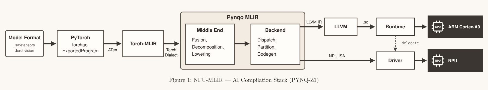
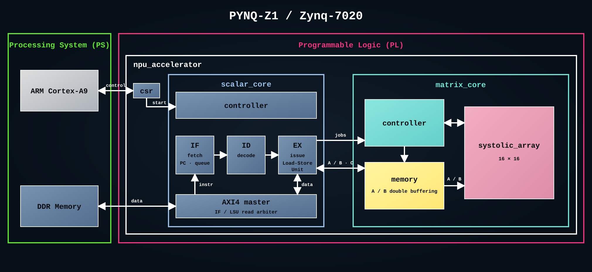

# NPU PYNQ

[](https://github.com/yenhao-huang/npu_in_pynq/actions/workflows/ci.yml)
[](https://github.com/yenhao-huang/npu_in_pynq/releases)
[](LICENSE)


An open-source neural-network accelerator stack for the PYNQ-Z1. It connects
bit-accurate quantized model contracts, deterministic export, a Python runtime,
instruction-stream NPU execution on the FPGA, reproducible Vivado builds, and Jupyter notebook
validation. Status: research and development.

## Contents

- [Features](#features)
- [How to build](#how-to-build)
- [Software Stack](#software-stack)
- [Hardware Architecture](#hardware-architecture)
- [Supported target and contracts](#supported-target-and-contracts)
- [Agentic Components](#agentic-components)
- [Contributing](#contributing)
- [License](#license)

## Features

| Capability | Status |
| --- | --- |
| Support Quantized ResNet-18 | Done |
| Customized EDA Tools | Done |
| Transformers | Done |
| RTL Optimization by Design Space Exploration | Undone |

## How to build

This README uses Linux Bash. Each example has one guide, `README.md`, for
Linux; on Windows, follow it in WSL. Run commands from the repository root
unless a step says otherwise.
The SmolLM build guide uses `dist/` for generated model assets and packages.

### Quick start

1. Download the package on your computer:
   [pynqo-resnet18-v1.0.8.tar.gz](https://github.com/yenhao-huang/npu-pynq/releases/download/v1.0.8/pynqo-resnet18-v1.0.8.tar.gz).
   It holds the compiled model, the overlay, the runtime and the notebook.
2. Copy it to the PYNQ-Z1:

   ```bash
   scp pynqo-resnet18-v1.0.8.tar.gz xilinx@192.168.2.99:~/jupyter_notebooks/
   ```

3. Log in to the board:

   ```bash
   ssh xilinx@192.168.2.99
   ```

4. Extract the package. It unpacks into `resnet18/`; `-m` avoids timestamp
   warnings when the board's clock is behind:

   ```bash
   cd ~/jupyter_notebooks
   tar -xzmf pynqo-resnet18-v1.0.8.tar.gz
   ```

5. Open the notebook in Jupyter at
   <http://192.168.2.99:9090/notebooks/resnet18/resnet18.ipynb> and run the
   cells in order. Pick a bundled picture or upload your own; the last cell
   prints the top-5 ImageNet labels, their scores, and a CORRECT or INCORRECT
   verdict.

SmolLM2-135M-Instruct comes the same way:
[pynqo-smollm-v1.0.8.tar.gz](https://github.com/yenhao-huang/npu-pynq/releases/download/v1.0.8/pynqo-smollm-v1.0.8.tar.gz)
unpacks into `smollm/`. Copy and extract it as in steps 2 to 4, then open
<http://192.168.2.99:9090/notebooks/smollm/smollm_safetensors.ipynb>, or run
it from the board's shell:

```bash
cd ~/jupyter_notebooks/smollm
sudo env XILINX_XRT=/usr /usr/local/share/pynq-venv/bin/python3 -m src.runtime.cli llm package \
  --overlay overlay/npu_accelerator.bit --chat --stream --prompt "What is the capital of France?" --max-new 32
```

### Build from scratch

Go to `examples/<model>/` and follow its README to export the model, build the
overlay, and package it for the board:
[ResNet-18](examples/resnet18/README.md) and
[SmolLM](examples/smollm-safetensors/README.md).

## Software Stack



PyTorch loads and quantizes the model (torchao) and exports an ExportedProgram.
Torch-MLIR imports it as the torch dialect. Pynqo MLIR runs the middle end
(fusion, decomposition, lowering to linalg) and the backend, which partitions
the graph between the two devices and generates code for each:

- **CPU:** LLVM IR, compiled by LLVM (`llc`, `ld.lld`) into a `.so` that the
  runtime runs on the Cortex-A9.
- **NPU:** NPU ISA programs. The runtime hands each NPU region to the driver
  through `__delegate__`, and the driver runs it on the NPU.

Note:

- **Host compile:** `python -m src.export.cli export` turns a model into a
  package.
- **Board run:** `python -m src.runtime.cli llm` loads that package on the
  PYNQ-Z1 and runs inference.
- **NPU driver:** runs on the Cortex-A9. For each NPU matrix multiplication it
  packs the activations into tiles, writes the program address to the NPU's
  registers, starts it, polls until it finishes, and unpacks the result.

## Hardware Architecture



The diagram groups the hardware by function: the Zynq processing system
controls the accelerator over AXI-Lite. The ISA front end fetches NPU programs
from DDR, decodes them into matrix jobs, and moves the A/B tiles in and the C
tiles out itself over its own AXI4 master on HP0. The accelerator contains the
controller, double-buffered operand memory, and systolic array. The overlay
defaults to a 16 x 16 array and also supports 8 x 8 and 2 x 2 builds.

## Supported target and contracts

| Area | Supported boundary |
| --- | --- |
| Board | PYNQ-Z1 |
| FPGA part | Zynq-7020, `xc7z020clg400-1` |
| Overlay | `npu_accelerator` with the ISA front end (ABI 1.1) |
| Arithmetic | Signed INT8 operands, exact INT16 products, saturating INT32 accumulation |
| Requantization | Q1.31 with explicit rounding and saturation contracts |
| Host tooling | Python and Bash (Linux/WSL); Vivado only for hardware builds |

## Agentic Components

### IC design tools

Give Claude Code, Codex, pi-agent and other compatible agents tools for RTL
linting, simulation, waveform debugging and synthesis. Install in Linux/WSL
or macOS with Node.js 20.11+:

```bash
npm install -g --foreground-scripts @jony2156/ai-eda-tools@0.1.1
ic-tools doctor
```

Connect Claude Code from your project root:

```bash
claude mcp add --transport stdio --scope project ic-tools -- \
  "$(command -v ic-tools)" serve --project "$PWD"
claude mcp list
claude
```

See the [tool guide](tools/ic/README.md) for capabilities and
[agent installation guide](tools/ic/docs/manual/installation.md) for Codex, pi
and environment requirements.

### Harness Engineering

- **Agent instructions:** [AGENTS.md](AGENTS.md) and [CLAUDE.md](CLAUDE.md)
  define repository context and working rules.
- **EDA skills:** [`.codex/skills/`](.codex/skills/) provides reusable
  development, deployment and IC design workflows, including hardware builds
  and PYNQ board delivery. Skills guide the agent's workflow; tools execute
  the design operations.
- **Git management:** [docs/rules/git/](docs/rules/git/) defines issue,
  branch, commit and pull-request workflows.
- **Environment and structure:** [environment.md](docs/rules/environment.md)
  and [filetree.md](docs/rules/filetree.md) define tool assumptions and where
  source, tests and generated artifacts belong.
- **Spec-Driven Development:** use the OpenSpec skills to propose, implement
  and archive changes under [openspec/](openspec/).

## Contributing

Work is issue-scoped: read [AGENTS.md](AGENTS.md) and the
[Git rules](docs/rules/git/) first. Pull requests target `dev`; promoting
`dev` to `main` is a human release decision.

## License

Licensed under the [Apache License, Version 2.0](LICENSE).
