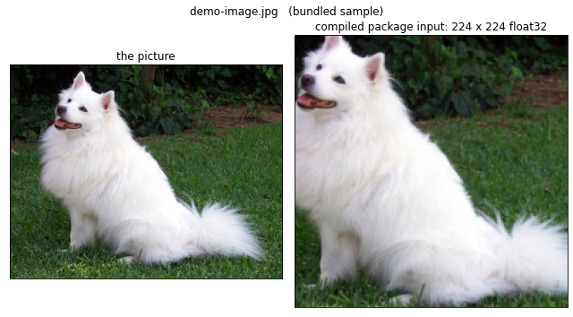
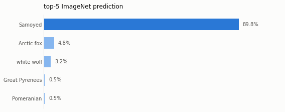

# Independent JIT and ResNet18 AOT results

Status: **PASS for all requested acceptance criteria**, including execution on
physical PYNQ-Z1. Campaign date: 2026-10-18 (Asia/Taipei). Branch:
`npu/issue119-a`, worktree `worktrees/npu-issue119-a`.

The existing worktree and issue claim were reused. Starting HEAD was
`beaf1f885360936e7dab97da6345190993c13e79`; its staged and unstaged software-stack
refactor was preserved. Changes remain uncommitted; nothing was pushed or merged.
The exact board software snapshot is identified by
[evidence/board-payload-manifest.json](evidence/board-payload-manifest.json).

## Acceptance

| Criterion | Evidence | Result |
| --- | --- | --- |
| Public ResNet18 uses AOT export/runtime | Existing MLIR frontend compiles host and ARM libraries; `ImageEngine` calls the compiled `forward` ABI | PASS |
| Preserve notebook block logic and picture prediction | Six stages retained; dropdown and ipywidgets 7/8 uploads; original/crop preview; top-5 chart and correctness verdict | PASS |
| Record block and total time | Final real-board run table below, complete machine-readable evidence | PASS |
| Optional JIT removal leaves active functionality intact | Entire `src/jit` physically hidden during active tests; board payload contains neither JIT nor export | PASS |
| Result.md and Reproduce.md | This document and [Reproduce.md](Reproduce.md) | PASS |
| Successful physical PYNQ execution | `pynq`, `armv7l`, Python 3.10.4, positive hardware counters and correct real photograph | PASS |

## Physical board result

The pinned photograph predicts **Samoyed**, class 258, probability
**89.80227552%**. It executes **21 NPU calls,
35,174 jobs, 1,814,073,344 MACs and
40,185,286 hardware cycles**. Poll count:
2,500,310. This is an ARM shared library calling the FPGA ISA
frontend, not host simulation or the optional interpreter.

| Notebook block | Wall seconds |
| --- | ---: |
| 1_connect | 0.009910 |
| 2_overlay_and_package | 5.005564 |
| 3_choose_picture | 0.202248 |
| 4_preprocess_and_preview | 16.862887 |
| 5_inference | 4.849262 |
| 6_prediction | 1.112165 |
| **Sum of six blocks** | **28.042036** |
| Full notebook, including kernel/protocol overhead | 47.449387 |

The block sum excludes human wait time between cells. Block 4 includes imports,
Pillow decoding, preprocessing, preview creation and inline display. Block 5 is
the compiled inference call. The figures below are outputs retrieved from this
physical notebook; the canonical `examples/resnet18/resnet18.ipynb` retains them.

Board deployment:
`/home/xilinx/jupyter_notebooks/npu-issue119-a-aot-20261018/resnet18_aot/`.
The existing 16 x 16, MAX_K=256 ISA BIT/HWH pair was copied from
`smollm-compiled-stage-20261009`. It was not rebuilt for this software change;
its precise build commit is not inferred from that directory name. Its
identities are recorded in [pynq-notebook.json](evidence/pynq-notebook.json):

- BIT SHA256: `bd6b8f44f2b25445aef61e7692beda62d85a35a84ccbf6448ce40ca4cc12f3db`
- HWH SHA256: `8ba3849b16c63faba539511c997a400f8b1f64c4f7f8707fae0f4a5af9d46748`
- Compiled model manifest SHA256: `c68b9108126f2e0e7cfeb39ae646ab9512f1c4ab7270f4e34979ddac53aab485`
- Input photograph SHA256: `f3f87bb8ab3c26c7ecfd3ac60421d7f32b0503d1d6c5baf8bac42ed93d86351a`

The board clock is not synchronized with the campaign date. All elapsed times
use monotonic clocks; no board timestamp is used to establish the date.

## Native host and compiler

Native host inference: **0.539524 s**; package load:
0.271304 s. All 1000 logits match the independent NumPy W8A8
reference with **maximum absolute difference 0.0**.
NumPy reference inference took 3.867728 s. Its stem,
residual-stage and classifier times are in
[numpy-reference.json](evidence/numpy-reference.json).

The official checkpoint SHA256 is
`f37072fd47e89c5e827621c5baffa7500819f7896bbacec160b1a16c560e07ec`.
Frontend graph creation took 2.401694 s and produced 63 weight arrays and
139059 MLIR characters. The compiled package uses 16 x 16 tiles, MAX_K=256,
21 contraction tasks and 11,729,440 weight bytes.

| Compiler block | Seconds |
| --- | ---: |
| partition | 430.518028 |
| pack_weights | 0.194934 |
| npu_lower | 1.768773 |
| codegen_host | 6.467577 |
| codegen_pynq | 10.992520 |
| **Compiler block sum** | **449.941833** |

This is a **cold** compiler run: `partition` includes the first CMake build and
link of npu-opt over the Windows-mounted Linux workspace. It is not a warm
partition-pass latency. Official LLVM/MLIR 22.1.8 Debian packages were extracted
into ignored `build/llvm22`, without installing system packages. Their versions
and hashes are in [llvm-packages.json](evidence/llvm-packages.json).

## Experiment loop and verification

| Hypothesis / command | Observation | Decision |
| --- | --- | --- |
| Hide all JIT with `verify_without_jit.py` | PASS: 97 core tests, 6 image/delivery tests, 35 matrix/delivery tests; 11 LLVM-dependent core tests skipped on Windows | Keep a removable optional package |
| `unittest discover -s src/jit/tests` | PASS: 90 tests | Preserve JIT functionality |
| `unittest discover -s src/jit/examples/resnet18/tests` | PASS: 87 tests after relocation and root-path fixes | Keep the complete legacy example inside JIT |
| `compile_staged.py stage` and `compile` | PASS: complete graph, host and ARM libraries | Proceed with native numeric checks |
| `reference_image.py` then `compare_native.py` | PASS: Samoyed and all 1000 native logits exactly match NumPy | Proceed to the physical board |
| First `execute_notebook.py` run | Physical PASS; inference 4.899762 s, block sum 23.415908 s; forced Agg backend suppressed visible figures | Enable notebook inline figures and rerun; retain first JSON separately |
| Second `execute_notebook.py` run | Physical PASS with both figures, final block table above | Accept this run |
| Additional Linux `test_ops` suite | 4 tests passed; 2 LLM tests failed to import because the available Linux Python is 3.11 and their existing f-strings require 3.12 | Record the environment limitation; do not alter unrelated LLM implementations |
| `git diff --check` | PASS | No whitespace defects |

The additional LLM failures are in existing `embedding.py` and
`linear_attention.py`, outside this ResNet change. The ResNet frontend, native
shared libraries and board runtime all executed successfully. No RTL was
changed for this task; lint/sim were not run as part of this unpushed software
change. The pre-existing worktree's other changes are not claimed as newly
validated by this campaign.

## Module boundaries

- `src/jit/` contains the interpreter, local DMA/overlay support, legacy example,
  integer reference, focused tests and frozen delivery helpers. It imports no
  active source package.
- `src/export/graphs/resnet18` owns checkpoint loading, BatchNorm folding and
  graph construction through the existing modular MLIR operators.
- `src/runtime/core/image.py` owns image preprocessing, inference and decoding.
  It imports no exporter or PyTorch. Overlay geometry and ISA capability are
  checked before physical allocation.
- `examples/resnet18` owns notebook interaction, host preparation, delivery and
  automated image acceptance. Release packaging excludes JIT, exporter and
  source checkpoints and verifies payload hashes.

JIT and AOT use different quantization pipelines. No bitwise equivalence between
them is claimed. Existing historical experiment logs were not rewritten.
Generated models, libraries and raw logs remain ignored under `model/` and
`build/`; only compact acceptance evidence is retained here.

## Interactive notebook path fix

A human-opened notebook initially used `artifacts/npu_matrix.bit`, while the
experiment deployment stores `resnet18_aot.bit` beside the notebook. The
automated run had supplied an environment override, masking this default-path
problem. The notebook now discovers either explicit deployed layout with its
matching HWH and preserves an explicit environment override. A mocked execution
of the real overlay cell passed with no override. The board notebook was backed
up and patched in place, and its receipt hash updated, without programming the
FPGA or interrupting the user kernel. The six image/delivery tests passed.
